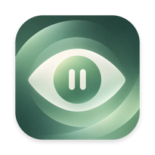

# EyeCare



EyeCare is a native macOS menu bar app for taking regular screen breaks. It supports macOS 13 and later, with English and Simplified Chinese selected through macOS language settings.

## Download

[Download EyeCare 1.2.0 for macOS](https://github.com/lightning-joyce/eyecare/releases/download/v1.2.0/EyeCare-1.2.0-4.zip). Unzip the download, move `EyeCare.app` to Applications, and open it. The ZIP contains build 4 for both Apple silicon and Intel Macs. The app is signed with the PURE INSIGHT TECHNOLOGY LTD Developer ID and notarized by Apple.

[Browse GitHub Releases](https://github.com/lightning-joyce/eyecare/releases) · [Download from gltlab.net](https://eyecare-updates.gltlab.net/EyeCare-1.2.0-4.zip)

ZIP SHA-256 `24c3fe0a402167983fdd2cc1dabaf6b2ed01c100455d11d39846644148145349`

## Screenshots

**Settings**


**20-second distance break**


## Run locally

Open `EyeCare.xcodeproj` in Xcode and run the EyeCare scheme. Click the eye icon in the menu bar to open Settings or preview a break. Install the app in Applications before testing its login item.

The project is generated from `project.yml`. Run `xcodegen generate` after changing the project specification or adding Swift files. Run the timing tests with:

```sh
xcodebuild -project EyeCare.xcodeproj -scheme EyeCare -destination 'platform=macOS' test
```

## Break behavior

- A 20-second distance break starts every 20 minutes of active screen time. Display sleep, system sleep, screen lock, and switching away from the macOS session pause counting until input resumes.
- A five-minute break starts after one hour of active screen time by default. Settings allows a long break interval of 1–24 hours and a duration of 1–60 minutes. Break time is excluded from both timers. A long break takes priority when both timers are due.
- With the screen on, two minutes without input counts as time away by default. Settings allows an idle threshold of 1–10 minutes. EyeCare excludes that time from both timers starting at the last input. A reminder that comes due after 30 seconds without input waits for the next input or a natural break.
- On return, an absence of at least 20 seconds resets the distance break timer. An absence that also meets the configured long break duration resets both timers.
- Use **Keep Counting for 30 Minutes** in the menu bar for reading, video, or meetings. During that time, idle input does not pause counting. Locking or sleeping your Mac still pauses it. Choose **Resume Idle Detection** to end the mode early.
- The overlay covers each connected display during a break. Click **End Break Early** or press **Esc** if you need to get back to work immediately. The next reminder follows the usual schedule.
- Launch at login is enabled on first run through Service Management. Later choices in the app or in System Settings are respected.

## Text size

Choose **Text Size…** in the EyeCare menu and drag the slider to set the Finder and file dialog font size from 10 to 32 pt in one-point increments. The panel shows the corresponding macOS reading level and browser font size as you drag. Select **Apply** to save and sync the displayed sizes. macOS apps can display the same reading level at different point sizes.

- On macOS 14 or newer, EyeCare sets the preferred reading size in Accessibility settings. On first use, allow EyeCare under **Privacy & Security → Accessibility**, then apply the size again. macOS applies this size to supported apps and interface elements that follow the preferred reading size.
- EyeCare also updates the default file text size in Finder and standard macOS Open and Save dialogs. Existing windows may need to be reopened, and Finder or the app that owns a dialog may need to be relaunched. Folder-specific views retain their own settings.
- Chrome, Edge, and Brave use their own default web font size. EyeCare changes it for local profiles after the browser quits normally. If a browser is open, the change is queued and will be picked up the next time the browser starts. This setting applies to web content where the page respects it.

## Automatic updates

Sparkle checks for updates in the background and downloads eligible updates to install when EyeCare quits. The menu bar also provides a manual check. The app verifies signed feeds and archives using its embedded EdDSA public key.

The [production appcast](https://eyecare-updates.gltlab.net/appcast.xml) advertises the latest release. The signed appcast in `updates/feed` is for bootstrapping the Worker.

## Release

Run the release command from the repository root with the intended version and build number.

```sh
./scripts/release.sh 1.2.1 5
```

Use an `x.y.z` version and a positive integer build number greater than the one in the live appcast. The script sets both values on the Xcode command line. It archives a universal Release build, exports it with Xcode's automatic Developer ID signing, submits it to Apple, and staples the notarization ticket. It then signs the Sparkle appcast and ZIP, deploys them to Cloudflare, and downloads both over HTTPS to verify their contents and signatures.

The release command requires the following maintainer credentials and tools.

- Xcode with the release Apple Developer account signed in and access to cloud-managed Developer ID Application signing. The default team is `Z65CXPU3NX`. Set `EYECARE_TEAM_ID` to use a different team.
- `asc` configured with an App Store Connect API key for notarization. Install Wrangler, `jq`, and Python 3, and authenticate Wrangler to the account that hosts the update Worker.
- The private Sparkle signing key that matches `SUPublicEDKey` in `Config/Info.plist`. Keep it outside the repository. The default path is `~/.config/eyecare/sparkle-ed25519`. Set `EYECARE_SPARKLE_KEY_FILE` to use a different path. Xcode resolves the pinned Sparkle tools automatically. Set `SPARKLE_TOOLS_DIR` to use an existing tools directory.

Use `--dry-run` to prepare signed assets and run Wrangler's deployment checks.

```sh
./scripts/release.sh 1.2.1 5 --dry-run
```

This submits the build to Apple for notarization and leaves the production appcast as it was. Both modes retain the archive, notarization logs, and release assets in the printed `.build/release-*` directory. Keep a copy of each published ZIP for rollback or support.

## License

EyeCare is available under the [MIT License](LICENSE).
