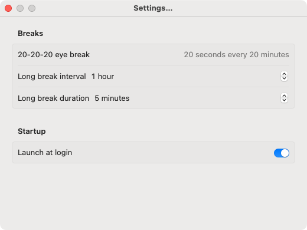
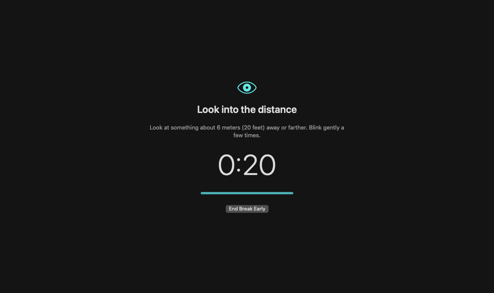

# EyeCare


EyeCare is a native macOS menu bar app for taking regular screen breaks. It supports macOS 13 and later, with English and Simplified Chinese selected through macOS language settings.

## Download

[Download EyeCare 1.0.0 for macOS](https://github.com/lightning-joyce/eyecare/releases/download/v1.0.0/EyeCare-1.0.0-2.zip). Unzip the download, move `EyeCare.app` to Applications, and open it. The ZIP contains build 2 for both Apple silicon and Intel Macs. The app is signed with the PURE INSIGHT TECHNOLOGY LTD Developer ID and notarized by Apple.

[Browse GitHub Releases](https://github.com/lightning-joyce/eyecare/releases) · [Download from gltlab.net](https://eyecare-updates.gltlab.net/EyeCare-1.0.0-2.zip)

ZIP SHA-256 `cf49d15f66fe338d2d2dacff7166e016868b9640e6a6eb8c15d5ce72b4dc670a`

## Screenshots

**Settings**



**20-second distance break**



## Run locally

Open `EyeCare.xcodeproj` in Xcode and run the EyeCare scheme. Click the eye icon in the menu bar to open Settings or preview a break. Install the app in Applications before testing its login item.

The project is generated from `project.yml`. Run `xcodegen generate` after changing the project specification or adding Swift files. Run the timing tests with:

```sh
xcodebuild -project EyeCare.xcodeproj -scheme EyeCare -destination 'platform=macOS' test
```

## Break behavior

- A 20-second distance break starts every 20 minutes of active screen time. Display sleep, system sleep, screen lock, and switching away from the macOS session pause counting. They also restart the continuous time used for distance breaks.
- A five-minute break starts after one hour of active screen time by default. Settings allows a long break interval of 1–24 hours and a duration of 1–60 minutes. Break time is excluded from both timers. A long break takes priority when both timers are due.
- The overlay covers each connected display until its countdown finishes. The app uses macOS windows for interruption and macOS continues to handle system shortcuts.
- Launch at login is enabled on first run through Service Management. Later choices in the app or in System Settings are respected.

## Automatic updates

Sparkle checks for updates in the background and downloads eligible updates to install when EyeCare quits. The menu bar also provides a manual check. The app verifies signed feeds and archives using its embedded EdDSA public key.

The [production appcast](https://eyecare-updates.gltlab.net/appcast.xml) advertises the latest release. The signed appcast in `updates/feed` is for bootstrapping the Worker.

## Release

Run the release command from the repository root with the intended version and build number.

```sh
./scripts/release.sh 1.0.1 3
```

Use an `x.y.z` version and a positive integer build number greater than the one in the live appcast. The script sets both values on the Xcode command line. It archives a universal Release build, exports it with Xcode's automatic Developer ID signing, submits it to Apple, and staples the notarization ticket. It then signs the Sparkle appcast and ZIP, deploys them to Cloudflare, and downloads both over HTTPS to verify their contents and signatures.

The release command requires the following maintainer credentials and tools.

- Xcode with the release Apple Developer account signed in and access to cloud-managed Developer ID Application signing. The default team is `Z65CXPU3NX`. Set `EYECARE_TEAM_ID` to use a different team.
- `asc` configured with an App Store Connect API key for notarization. Install Wrangler, `jq`, and Python 3, and authenticate Wrangler to the account that hosts the update Worker.
- The private Sparkle signing key that matches `SUPublicEDKey` in `Config/Info.plist`. Keep it outside the repository. The default path is `~/.config/eyecare/sparkle-ed25519`. Set `EYECARE_SPARKLE_KEY_FILE` to use a different path. Xcode resolves the pinned Sparkle tools automatically. Set `SPARKLE_TOOLS_DIR` to use an existing tools directory.

Use `--dry-run` to prepare signed assets and run Wrangler's deployment checks.

```sh
./scripts/release.sh 1.0.1 3 --dry-run
```

This submits the build to Apple for notarization and leaves the production appcast as it was. Both modes retain the archive, notarization logs, and release assets in the printed `.build/release-*` directory. Keep a copy of each published ZIP for rollback or support.

## License

EyeCare is available under the [MIT License](LICENSE).
